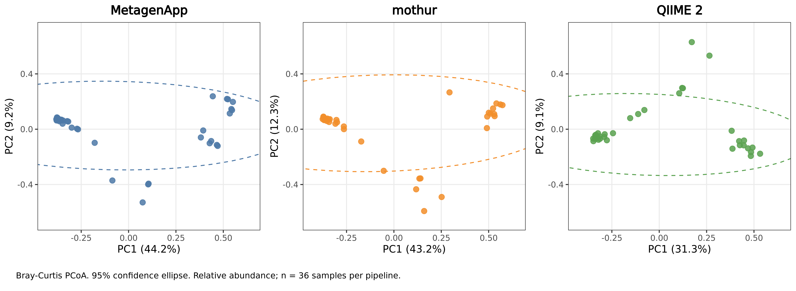

# MetagenApp

[](https://doi.org/10.5281/zenodo.23325860)

**MetagenApp** is a reproducible 16S/18S metabarcoding pipeline that turns
paired-end Illumina reads into taxonomically annotated OTU tables. It is built
around VSEARCH and a naive Bayes classifier after Wang et al. (2007) (`wang`), and is designed
to run quickly and with modest memory on standard hardware.

Developed by José Mijail Campos Compeán (Universidad Autónoma Metropolitana, Mexico).
A web interface built on this pipeline is available at **[demo.bioagens.com](https://demo.bioagens.com)**.

---

## Benchmark: MetagenApp vs mothur vs QIIME 2 (v2, ECCB 2026)

> **Manuscript (v1.1).** The results reported in the manuscript use MetagenApp
> [v1.1](https://doi.org/10.5281/zenodo.23325861). Its statistics and scripts are in
> [`results_v1.1/`](results_v1.1/), and the outputs of the three pipelines are on Zenodo
> ([10.5281/zenodo.23349702](https://doi.org/10.5281/zenodo.23349702)). The section below
> describes the earlier v2 benchmark shown on the ECCB 2026 poster; its numbers differ from
> the manuscript.

Presented at **ECCB 2026** (Geneva, poster A-B.05):
*"Impact of bioinformatic pipeline selection on microbial community inference:
a comparative analysis across pipelines including MetagenApp"*
— [poster PDF](docs/ECCB2026_poster.pdf).

**Design.** 36 paired-end MiSeq 16S V3–V4 samples (pharyngeal and nasal;
González-García et al. 2024), 1.52 M raw reads. All three pipelines used the
same anchored 341F/805R primer trimming (cutadapt) and the same curated
SILVA 138.2 NR99 reference. MetagenApp and mothur cluster at 97% similarity;
QIIME 2 infers ASVs with DADA2. Each pipeline was run in isolation on the same
hardware (16 threads). Alpha diversity was rarefied to 1,414 reads/sample.

### Key results

- **Biological signal dominates the pipeline effect.** In a combined
  PERMANOVA (Bray–Curtis, phylum level, 9,999 permutations), sample identity
  explains **88.9%** of the variance and pipeline choice **1.9%**
  (both p < 0.001); dispersion does not differ between pipelines
  (betadisper p = 0.90).
- **High inter-pipeline concordance.** Mantel r = 0.94 for all three pairwise
  comparisons (p < 0.001).
- **Pipeline effects on alpha diversity are metric-dependent.** Richness and
  Chao1 differ between all pipelines (Friedman + Holm-corrected Wilcoxon);
  Shannon diversity does not differ between MetagenApp and QIIME 2
  (adjusted p = 0.27).
- **Lower computational cost.** MetagenApp ran ~9.7× faster than mothur with
  ~5× less peak memory.



| | MetagenApp | mothur | QIIME 2 |
|---|---|---|---|
| Feature inference | VSEARCH, 97% OTUs | OptiClust, 97% OTUs | DADA2 ASVs |
| Final features | 12,599 OTUs | 7,552 OTUs | 1,332 ASVs |
| Reads retained (final table / raw) | 69.9% | 68.2% | 66.5% |
| Wall-clock time | **14 min 55 s** | 2 h 24 min | 20 min 43 s |
| Peak memory | **6.8 GB** | 33.8 GB | 14.1 GB |
| Median observed richness (rarefied) | 122 | 83 | 104 |
| Median Shannon (rarefied) | 3.09 | 2.87 | 3.41 |

Phylum-level composition is broadly conserved across pipelines, and
unclassified reads stay below 0.5% for all three.

**Limitations.** Richness estimates are the most pipeline-sensitive metric,
with MetagenApp producing more features than mothur or QIIME 2. The next step
is to evaluate ASV-style inference in MetagenApp to test whether richness
inflation can be reduced while keeping its efficiency.

Summary statistics and PCoA coordinates are in [`results_v2/tables/`](results_v2/tables/).

---
## Features

- `wang` classifier (recommended for 16S) — Wang et al. (2007) naive Bayes, 8-mers, 100 bootstraps, SILVA 138.2 NR99
- UPARSE-style OTU formation: unique sequences with ≥2 reads form OTUs, singletons are mapped back at 97%
- Custom classifier (`naive-v2`) — Wang-style bootstrap k-mer confidence scoring
- SILVA 138.2 NR99 reference files on Zenodo ([10.5281/zenodo.23326733](https://doi.org/10.5281/zenodo.23326733)); legacy SILVA 138 model also available
- Alignment fallback — EDLib pairwise alignment for borderline sequences (94% threshold, Yarza et al. 2014)
- Optional primer trimming (`--primer-f` / `--primer-r`, cutadapt)
- Accepts `.fastq`/`.fq` input, plain or gzipped
- 26-step pipeline — merge → filter → cluster → classify → OTU table
- Multiple execution modes: `student`, `premium`, `turbo`, `ref`, `qa`
- Modern CLI with configurable profiles

---

## Installation

### Requirements

- [Conda](https://docs.conda.io/en/latest/miniconda.html) (Miniconda or Anaconda)

### Install

```bash
git clone https://github.com/mijailcampos/metagenapp
cd metagenapp
conda env create -f environment.yml
conda activate metagenapp
python download_model.py
```

`conda env create` installs all tools and Python dependencies in one step, including `vsearch`, `mafft`, `edlib`, and the `metagenapp` package itself.

`download_model.py` downloads the v1.1 reference files (~1.9 GB: `wang` classifier + SILVA 138.2 NR99 sequences and taxonomy) from Zenodo ([10.5281/zenodo.23326733](https://doi.org/10.5281/zenodo.23326733)) into `~/.metagenapp/refs/`, verifying their SHA-256 checksums. The legacy SILVA 138 `naive-v2` model (~2.3 GB, [10.5281/zenodo.20076968](https://doi.org/10.5281/zenodo.20076968)) is available with `python download_model.py --set v1.0`.

To use a custom model path:

```bash
python download_model.py --dest /path/to/refs
export METAGENAPP_REFS=/path/to/refs  # add to ~/.bashrc
```

### Disk space

| Component | Size |
|---|---|
| Repository | ~20 MB |
| Conda environment | ~2–3 GB |
| v1.1 reference files (Zenodo) | ~1.9 GB |
| **Total** | **~4–5 GB** |

### Platform support

| Platform | Support |
|---|---|
| Linux | Full |
| macOS | Full |
| Windows | Requires WSL2 (vsearch has no native Windows binary) |

---

## Quick start

```bash
# Run on example data (3 samples, ~20k reads each)
metagenapp -i example_data/ -o results/ --threads 4 --mode ref

# Full run with a profile (auto-generates timestamped output directory)
metagenapp --profile ref --input /path/to/fastq/

# Resume from a specific step
metagenapp -i data/ -o results/ --from-step clasificacion_tax
```

In `ref` mode, de novo chimeras (VSEARCH `--uchime_denovo`) are removed sample by
sample, in parallel, since v1.2 (`--chimera-mode per-sample`, default). Use
`--chimera-mode pooled` for the v1.1 behaviour (all samples together, one core).

---

## Pipeline overview

26 sequential steps, from paired FASTQ to OTU table with taxonomy:

```
FASTQ R1 + R2
    ↓ [01] Merge paired reads (VSEARCH mergepairs)
    ↓ [02] Quality filter (length, ambiguities)
    ↓ [03] Dereplicate + count per sample
    ↓ [04] Reference alignment (VSEARCH, 70% identity)
    ↓ [09] Trim region of interest
    ↓ [10] Cluster at 97% → centroids + UC file
    ↓ [11] Extract centroids (mode-dependent)
    ↓ [12–18] MAFFT alignment + chimera removal (student/premium/turbo)
    ↓ [20] Taxonomic classification  ←  core step
    ↓ [21] Remove non-target lineages (chloroplasts, mitochondria)
    ↓ [22–26] OTU table (per sample, merged)
```

### Execution modes

| Mode | Description |
|---|---|
| `ref` | Publication grade — EDLib alignment, no MAFFT |
| `premium` | Balanced — MAFFT alignment |
| `turbo` | Max speed — no alignment |
| `student` | Low resource — 10,000 centroid cap |
| `qa` | Quality control only |

---

## Classifier: wang (recommended for 16S)

Implementation of the naive Bayes classifier of Wang et al. (2007)
(`metagenapp_core/models/wang_engine.py`), used in the v1.1 benchmark.

1. Words = overlapping 8-mers (no ambiguous bases), counted once per sequence
2. Assignment = taxon with the highest summed log word probability
3. Confidence = 100 bootstraps of len(words)/8 words drawn with replacement
4. Each sequence gets its own random generator derived from a global seed and its
   content, so results do not depend on file order, batch size or thread count
5. Lineage reported down to the deepest rank with confidence ≥ 0.80, truncated at
   genus (`WANG_MAX_RANK = 6`); the full species-level confidences are kept in
   `*.wang_confidence.taxonomy`

**Model (v1.1):** SILVA 138.2 NR99 Bacteria + Archaea, 83,759 classes (to species),
sparse format, ~1.2 GB on disk.

## Classifier: naive-v2

Wang-style bootstrap confidence scoring over a k-mer inverted index.

1. Extract k-mers from query sequence
2. Discard k-mers with `psize >= 20` (too generic)
3. Sum k-mer weights per taxon at each taxonomic level
4. Bootstrap (100 iterations): resample k-mer pool → vote
5. Assign deepest level with confidence >= 0.60

**Model (v1.0):** SILVA 138 NR99, 83,000 taxa, confidence threshold 0.60.

---

## Repository structure

```
metagenapp/
├── metagenapp/           # CLI and pipeline orchestration
│   ├── cli/main.py       # Entry point (Typer)
│   ├── pipeline/         # 26-step pipeline modules
│   └── metagen_config.py # Global config and paths
├── metagenapp_core/      # Classification engines
│   ├── models/           # naive-v2, kraken-lite
│   └── utils/            # k-mer generation, LCA
├── scripts/              # Paper figures and model training
│   ├── Figure*.R         # Benchmark figures
│   ├── train_naive_v2.py # Train a new naive-v2 model
│   ├── build_silva_trainset.py
│   └── dev/              # Internal / experimental scripts
├── results_v1.1/         # Manuscript benchmark: statistics scripts, tables, figure
├── results_v2/           # Benchmark v2 (ECCB 2026 poster, historical)
├── docs/                 # ECCB 2026 poster
├── results_v1/           # Benchmark v1.0 (superseded, see below)
│   ├── tables/           # TSV tables (OTU, taxonomy, resources)
│   ├── figures/          # PDF/PNG figures
│   ├── logs/             # /usr/bin/time -v timing logs
│   ├── raw_outputs/      # Pipeline outputs (MetagenApp, Mothur, QIIME 2)
│   └── COMMIT_HASH.txt   # Exact commit and command used
├── example_data/         # 3 public 16S samples for testing (~20k reads)
├── requirements.txt
├── pyproject.toml
├── VERSION.txt
└── LICENSE
```

---

## Reproducing the benchmark

### v1.1 (manuscript, ECCB 2026 Research Topic)

The manuscript results (36-sample benchmark and three mock communities) were
produced with tag [`v1.1`](https://github.com/mijailcampos/metagenapp/releases/tag/v1.1):

```bash
export METAGENAPP_REFS=/path/to/metagenapp_refs
metagenapp -i <fastq_dir> -o <out_dir> \
  --mode ref --marker 16S --classifier wang \
  --primer-f CCTACGGGNGGCWGCAG --primer-r GACTACHVGGGTATCTAATCC \
  --min-length 400 --max-length 440 --max-ambigs 0 --max-poly 8 -t 16
```

Reference files expected under `$METAGENAPP_REFS/16S_silva1382_full/`, deposited
on Zenodo ([10.5281/zenodo.23326733](https://doi.org/10.5281/zenodo.23326733);
`python download_model.py --dest $METAGENAPP_REFS`):

| File | Built with |
|------|------------|
| `silva1382_full_derep.fasta` / `.tax` | `scripts/build_silva_trainset.py` → `scripts/build_fulllength_reference.py` |
| `wang_silva1382_full_species.npz` | `python metagenapp_core/models/wang_engine.py train --fasta silva1382_full_all.fasta --tax SILVA_NR99_BacArc.tax --output wang_silva1382_full_species.npz` |

The classifier was validated against mothur `classify.seqs` on the same 90/10
split of SILVA 138.2 (`scripts/cv_*.py`).

Outputs of MetagenApp, mothur and QIIME 2 (36 libraries and three mock communities),
with the mothur and QIIME 2 reference files, are on Zenodo
([10.5281/zenodo.23349702](https://doi.org/10.5281/zenodo.23349702)). The statistics,
tables and beta-diversity figure are regenerated from them with
`bash results_v1.1/run_all.sh` (see [`results_v1.1/README.md`](results_v1.1/README.md)).

### v2 (ECCB 2026 poster, superseded by v1.1)

MetagenApp command used in the v2 benchmark:

```bash
metagenapp -i <fastq_dir> -o <out_dir> \
  --mode ref --marker 16S --classifier naive-v2 --model-type silva \
  --primer-f CCTACGGGNGGCWGCAG --primer-r GACTACHVGGGTATCTAATCC \
  --min-length 400 --max-length 440 --max-ambigs 0 --max-poly 8 -t 16
```

The v2 benchmark used a `naive-v2` model trained on **SILVA 138.2 NR99**
(Bacteria, Archaea and Eukaryota; minimum length 900/1200/1400 bp per domain,
≤5 degenerate bases, homopolymers ≤8, as in QIIME 2's RESCRIPt workflow), built
with `scripts/build_silva_trainset.py` and `scripts/train_naive_v2.py`.
This model is not yet on Zenodo (the current Zenodo
release is the SILVA 138 model); it is available on request and will be
published in a new Zenodo version. The mothur and QIIME 2 scripts and
the raw outputs are also available on request.

### v1.0 (superseded)

The first benchmark (tag [`v1.0`](https://github.com/mijailcampos/metagenapp/releases/tag/v1.0),
[`results_v1/`](results_v1/)) ran QIIME 2 without primer trimming, which
reduced its read retention (12.6%) and made the comparison unfair to QIIME 2.
It is kept for transparency and is superseded by the v2 benchmark above,
where all three pipelines share the same primer trimming and reference.

---

## Changes in v1.2

- De novo chimera removal per sample, in parallel (`--chimera-mode per-sample`,
  now the default): one single-threaded `vsearch --uchime_denovo` per sample, as
  mothur `chimera.vsearch dereplicate=t`. A unique flagged as chimeric is removed
  only in the samples where it was flagged.
- On 40 marine 16S V1–V3 samples (32 threads) the whole run took 0.7 h instead of
  5.5 h with v1.1, with the same community structure (Mantel r = 0.99 between
  versions; mean genus-level Bray-Curtis 0.045 per sample). On four Zymo mock
  communities, accuracy was unchanged.
- `--chimera-mode pooled` keeps the v1.1 behaviour. The manuscript results
  were produced with tag `v1.1` (see below).

---

## Citation

If you use MetagenApp, please cite the software release you used. The version
used in the ECCB 2026 manuscript is v1.1:

> Campos Compeán, J.M. (2026). *MetagenApp v1.1* (v1.1). Zenodo.
> https://doi.org/10.5281/zenodo.23325861

Reference files (SILVA 138.2 NR99, `wang` classifier):

> Campos Compeán, J.M. (2026). *MetagenApp v1.1 — 16S reference files (SILVA 138.2
> NR99, Wang classifier)*. Zenodo. https://doi.org/10.5281/zenodo.23326733

Benchmark outputs (MetagenApp, mothur and QIIME 2) and mothur/QIIME 2 reference files:

> Campos Compeán, J.M. (2026). *MetagenApp v1.1 benchmark — outputs of MetagenApp,
> mothur and QIIME 2, and reference files* (1.1). Zenodo.
> https://doi.org/10.5281/zenodo.23349702

The badge at the top ([10.5281/zenodo.23325860](https://doi.org/10.5281/zenodo.23325860))
is the concept DOI: it covers all versions and always resolves to the latest one.

Poster:

> Campos Compeán, J.M. (2026). Impact of bioinformatic pipeline selection on
> microbial community inference: a comparative analysis across pipelines
> including MetagenApp. Poster A-B.05, ECCB 2026, Geneva.

A full manuscript is in preparation.

---

## License

MIT — see [LICENSE](LICENSE).
